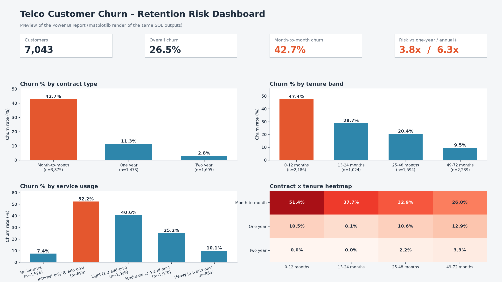

# Customer Churn Analysis: Identifying the Highest-Risk Retention Segment

**SQL · Python · Power BI**



> Segmented 7,043 Telco customers by contract type, tenure and service usage in SQL, validated the
> findings statistically in Python, and built a Power BI dashboard with churn rate % per segment and
> drill-through filters.

## Key finding

**Month-to-month customers churn at 42.7%, which is 3.8x the rate of one-year customers (11.3%) and 6.3x the rate of all annual+ customers (6.8%).**

| Contract | Customers | Churned | Churn rate | vs. Month-to-month |
|---|---:|---:|---:|---|
| Month-to-month | 3,875 | 1,655 | **42.7%** | - |
| One year | 1,473 | 166 | 11.3% | 3.8x lower |
| Two year | 1,695 | 48 | 2.8% | 15.1x lower |
| *Annual+ combined* | 3,168 | 214 | 6.8% | 6.3x lower |

Why it matters:

- Month-to-month customers are **55% of the base but 89% of all churners** (1,655 of 1,869) and **87% of monthly recurring revenue lost** (about $120.8K of $139.1K).
- Risk is concentrated early: **0-12 month** customers churn at 47.4% vs 9.5% for customers with 49+ months.
- Highest-risk cell: **month-to-month, 0-12 months, internet only (no add-ons): 60.2% churn**.
- Customers with **5-6 add-on services churn at 10.1%** vs 52.2% for internet-only customers, so product depth is protective.
- Fiber optic customers churn at 41.9% vs 19.0% for DSL.

**Recommendation:** target month-to-month customers in their first year with a discounted annual-contract
offer, and bundle 2-3 add-ons (security, backup, tech support) during onboarding.

### Is it real, or just a tenure/price effect?

`python/03_statistical_validation.py` checks this:

| Test | Result |
|---|---|
| Chi-square (contract group vs churn) | chi2 = 1,154, p < 1e-250 |
| Relative risk, month-to-month vs annual+ | 6.3x (95% CI 5.5-7.2) |
| Relative risk, month-to-month vs one-year | 3.8x (95% CI 3.3-4.4) |
| Logistic regression odds ratio, unadjusted | 10.3 |
| Logistic regression odds ratio, **adjusted** for tenure, monthly charges, add-ons, senior status | **3.0** |

Part of the raw gap is explained by new, higher-paying customers sitting on month-to-month plans, but
**month-to-month customers still have about 3x the odds of churning after controlling for those factors**.

## Repository structure

```
telco-churn-analysis/
├── data/
│   └── Telco-Customer-Churn.csv      # IBM Telco sample dataset (7,043 rows)
├── sql/
│   ├── 01_create_views.sql           # cleaning + segment derivation (tenure, usage, contract group)
│   └── 02_churn_analysis.sql         # 10 analysis queries (CTEs, window functions, relative risk)
├── python/
│   ├── config.py
│   ├── 01_load_to_sqlite.py          # CSV -> SQLite, creates the view
│   ├── 02_run_sql_analysis.py        # runs SQL, exports tables for Power BI
│   ├── 03_statistical_validation.py  # chi-square, relative risk, logistic regression
│   └── 04_make_charts.py             # PNG charts + dashboard preview
├── powerbi/
│   ├── DASHBOARD_GUIDE.md            # step-by-step build, DAX measures, drill-through setup
│   ├── telco_theme.json              # importable theme
│   └── data/                         # CSVs generated for Power BI
├── images/
├── requirements.txt
└── run_all.sh
```

## Methodology

1. **Clean (SQL).** 11 customers with `tenure = 0` have blank `TotalCharges`; set to 0. `Churn` Yes/No becomes a 1/0 flag.
2. **Segment (SQL).**
   - *Contract type:* month-to-month, one year, two year.
   - *Tenure band:* 0-12, 13-24, 25-48, 49-72 months.
   - *Service usage:* no internet, internet only, light (1-2 add-ons), moderate (3-4), heavy (5-6), where add-ons are online security, backup, device protection, tech support, streaming TV and streaming movies.
3. **Measure.** Churn rate % = churned customers / customers per segment, plus average monthly charge and share of total churners. Segments with fewer than 100 customers are excluded from the risk ranking.
4. **Validate (Python).** Significance test and multivariate model to rule out confounding.
5. **Visualise (Power BI).** Churn rate % per segment, contract x tenure heatmap, slicers, drill-through to customer-level detail.

## Run it

```bash
git clone https://github.com/<codewithyashu2/telco-churn-analysis.git
cd telco-churn-analysis
pip install -r requirements.txt
./run_all.sh line, because that scripts doesn't work on windows. on windows, run the four scripts in the python/ folder in order(01 to 04)
```

Then follow [`powerbi/DASHBOARD_GUIDE.md`](powerbi/DASHBOARD_GUIDE.md) to build the report from `powerbi/data/*.csv`.
You can also run the queries in `sql/02_churn_analysis.sql` directly against `data/telco_churn.db`
with any SQLite client.

### Porting notes (SQL Server / PostgreSQL)

- Boolean sums such as `(OnlineSecurity = 'Yes') + ...` become `CASE WHEN ... THEN 1 ELSE 0 END` terms.
- `CAST(TotalCharges AS REAL)` becomes `TRY_CAST(NULLIF(TRIM(TotalCharges), '') AS DECIMAL(10,2))` (SQL Server) or `NULLIF(TRIM(TotalCharges), '')::numeric` (PostgreSQL).
- `LIMIT 10` becomes `TOP 10` in SQL Server.

## Tech stack

SQL (SQLite dialect; CTEs, window functions) · Python (pandas, SciPy, scikit-learn, matplotlib) · Power BI (DAX, drill-through, conditional formatting)

## Data source

IBM Telco Customer Churn sample dataset, publicly available via the
[IBM telco-customer-churn-on-icp4d repository](https://github.com/IBM/telco-customer-churn-on-icp4d)
and Kaggle. It is a fictional dataset provided for educational use; check the source's licence before redistributing.
